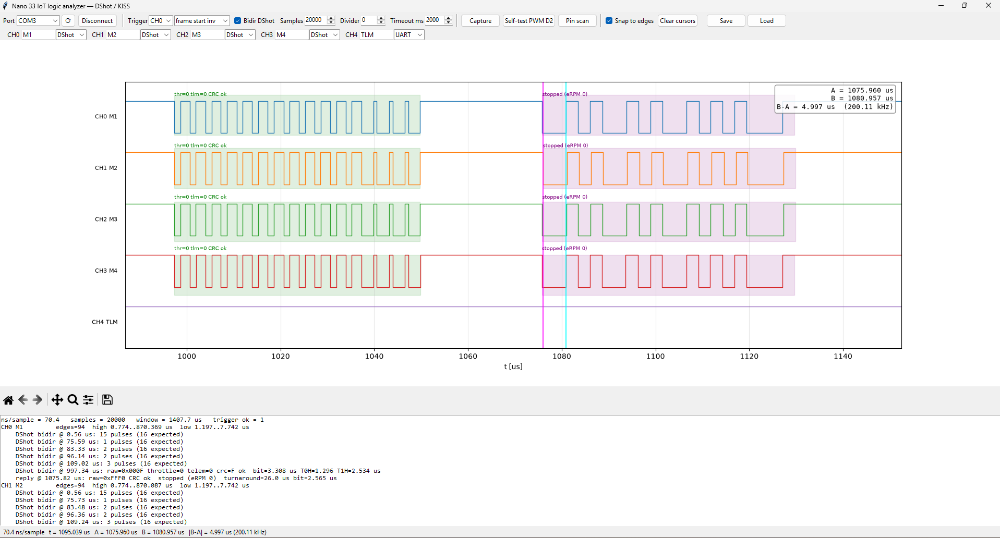
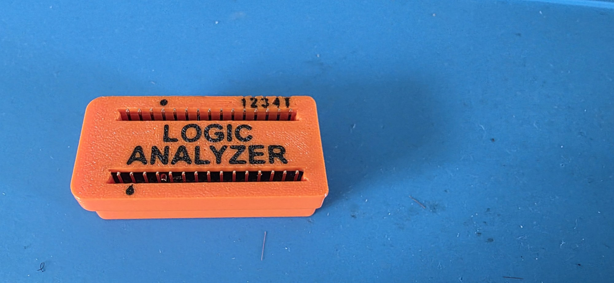

# DShot300 Logic Analyzer with Arduino Nano 33 IoT

A small 5-channel logic analyzer for bringing up DShot300 ESC links: four motor
lines plus the ESC telemetry wire, sampled at ~10 MSa/s (~100 ns resolution),
with decoders for DShot frames, bidirectional DShot replies and KISS/UART
telemetry. Development aid, not a calibrated instrument.



| Part | What |
|---|---|
| `logic_nano33iot/logic_nano33iot.ino` | Nano 33 IoT sketch: samples 5 pins at ~10 MSa/s into RAM, streams run-length data over USB |
| `logic_gui.py` | Python/Tk GUI: traces, cursors, DShot + UART/KISS decoders, save/load |
| `case/` | 3D-printable two-part case (Fusion script, STEP, STL, Bambu Studio project) |

## Hardware

- Arduino Nano 33 IoT (SAMD21, 3.3 V logic, **not 5 V tolerant**)
- Dupont wires to the signals under test, common ground
- optional: the printed case in `case/`



All five inputs must stay at 3.3 V levels. DShot lines from a 3.3 V flight
controller are fine; check the level before probing anything else (a push-pull
5 V output or an ESC power pad will damage the Nano).

| Nano | Channel | Suggested signal |
|---|---|---|
| D8  | CH0 | Motor 1 DShot |
| D9  | CH1 | Motor 2 DShot |
| D10 | CH2 | Motor 3 DShot |
| D11 | CH3 | Motor 4 DShot |
| D12 | CH4 | ESC telemetry (pad T, UART 115200, KISS format) |
| GND | – | common ground |

D13 is not used: it carries the on-board LED, which would load a line.
D12 has the internal pull-up enabled by default because the ESC's telemetry pad
idles low when the ESC is not driving it (`p` command toggles it).

## Install

```
pip install -r requirements.txt
```

Flash `logic_nano33iot/logic_nano33iot.ino` with the Arduino IDE (board
"Arduino Nano 33 IoT", SAMD core). Then:

```
python logic_gui.py                 # GUI, pick the Nano's serial port, Capture
python logic_gui.py capture.json    # open a saved capture offline
python logic_gui.py --selftest      # run the decoders on synthetic frames, no hardware
```

## First use: self-test

1. Jumper **D2 → D8**. In the GUI: Connect, then **Self-test PWM D2**, then
   **Capture** with trigger CH0 rising.
2. Expected: CH0 shows a square wave, high ≈ 1.667 µs, period ≈ 3.333 µs
   (cursor A/B delta, or the CH0 line in the report). The PWM comes from the
   SAMD21's TCC0 at 48 MHz, so this checks the sampling clock against a
   crystal-derived DShot300 bit period. Press Self-test again to release D2.

## Using it

- Trigger on the motor channel you are sending on with **frame start** (a rising
  edge after at least ~100 µs of low), so the capture begins at bit 15 of a
  frame. The window at full rate is ~2 ms, so a 1 kHz stream gives one or two
  complete frames per capture.
- The report lists every decoded frame: raw word, throttle, telemetry bit, CRC
  check, measured bit period, mean T0H and mean T1H. A frame with the wrong
  pulse count or a failed CRC is marked orange/red on the trace.
- **Bidirectional DShot:** tick **Bidir DShot** in the top bar. All DShot
  channels are then decoded as idle high with low pulses and the inverted CRC.
  The trigger switches between **frame start** and **frame start inv** (a
  falling edge after at least ~100 µs of high) with the tick. The setting is
  saved with the capture.
- **Bidir reply decoder** (with Bidir DShot on): the first falling edge 5–150 µs
  after each CRC-ok frame starts the ESC's reply. Decoded as AM32/BLHeli_32
  send it: NRZI (an edge on a slot boundary = GCR 1), 4b/5b GCR, 12 bit +
  inverted nibble-XOR CRC. The bit time starts at 2.667 µs (5/4 × DShot300)
  and is re-estimated from the edges. Shown in purple (red = CRC fail): eRPM,
  mechanical rpm (`POLE_PAIRS` in `logic_gui.py`, default 7), "stopped" for
  0xFFF, or the EDT type and value. The report also lists the turnaround and
  the measured bit time.
- CH4 with the UART decoder shows the KISS reply after a frame with the
  telemetry bit set: 10 bytes, CRC-8 check, decoded fields (temperature,
  voltage, current, mAh, eRPM). Not every ESC fills every field.
- Divider > 0 slows sampling for a longer window (e.g. to see the ESC's
  ~30 µs turnaround plus the whole 870 µs KISS packet in one capture). The
  exact ns/sample is always measured by TC4 and shown in the status line.
- **Pin scan** reads D2..D12 a few thousand times and reports the high count per
  pin: a PWM line shows a stable intermediate count, floating pins random ones.
  Use it when a trace stays flat to see where the wire really is.
- Left click = cursor A, right click = cursor B; drag a cursor by grabbing it;
  "Snap to edges" pulls a cursor onto the nearest transition of the channel
  under the pointer. The A/B/delta readout sits in the plot corner. Mouse
  wheel zooms, toolbar pans. Save stores the capture as JSON.

## How the sketch samples

The five inputs all sit in byte 2 of PORTA (PA16..PA23), so one 8-bit read of
the PORT IN register captures every channel at once. A tight unrolled loop
copies that byte into a 20 000-byte RAM buffer as fast as the core can (about
10 MSa/s). TC4 timestamps the start and end of the loop, so the exact ns/sample
is measured, not assumed, and sent with every capture. The buffer is run-length
encoded before it goes over USB CDC. The serial protocol is documented in the
sketch header (`h` prints the command list).

## Limits

- No pre-trigger: the capture starts a few samples after the trigger edge.
- 20 000 samples of RAM. At full rate that is ~2 ms; use the divider for more.
- Interrupts are off during arm + capture, so the USB link stalls until the
  trigger fires or the timeout (default 2 s) expires.
- The decoders are timing-based; a capture with the divider set so coarse that
  a 1.25 µs pulse spans fewer than ~4 samples will misclassify bits.

## License

MIT, see `LICENSE`.
